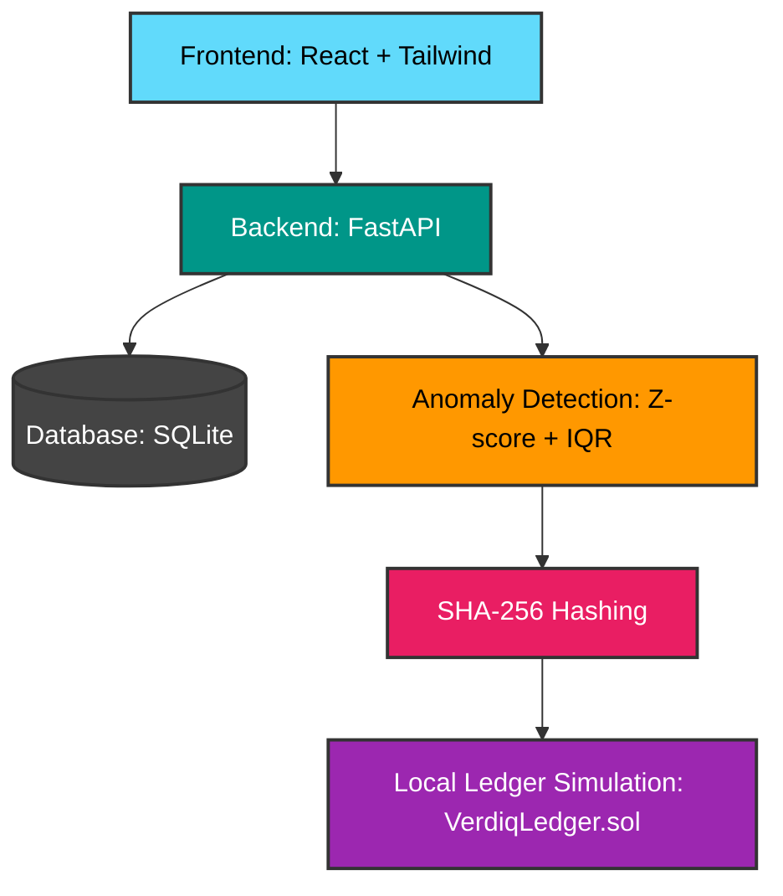

# Verdiq — Environmental Data Integrity Platform

> IEEE ClimateChain Global Hackathon 2026 | Track: Climate Data & Environmental Monitoring

Verdiq is an AI-assisted environmental data integrity platform that detects 
anomalies in sensor readings and anchors cryptographic evidence on a blockchain 
ledger. It solves two distinct problems: validating whether environmental data 
is statistically plausible, and proving whether it has been tampered with after 
collection.

## The Two-Part Trust Model

**Layer 1 — AI validates plausibility**
Statistical heuristics (z-score, IQR bounds, rolling mean) evaluate raw sensor 
readings and flag statistically unusual values with plain-language explanations.

**Layer 2 — Blockchain ledger proves provenance**
A SHA-256 hash of every registered batch is stored on a local simulation of the 
VerdiqLedger.sol smart contract, engineered for Polygon Amoy testnet. Any 
post-registration alteration is immediately detectable via the verify endpoint.

## Architecture


## Tech Stack

| Layer | Technology |
|---|---|
| Frontend | React 19, Tailwind CSS, Vite |
| Backend | Python, FastAPI, Uvicorn |
| Anomaly Detection | Pandas, SciPy (Z-score + IQR) |
| Storage | SQLite |
| Hashing | SHA-256 |
| Blockchain | Polygon Amoy (VerdiqLedger.sol — local simulation) |

## Running Locally

### Backend

```bash
cd backend
pip install -r requirements.txt
uvicorn main:app --reload
```

Backend runs at `http://localhost:8000`

### Frontend

```bash
cd frontend
npm install
npm run dev
```

Frontend runs at `http://localhost:5173`

### Environment Variables

Create `backend/.env`:
GEMINI_API_KEY=your_key_here
CONTRACT_ADDRESS=simulated
LEDGER_MODE=local

## API Endpoints

| Method | Endpoint | Description |
|---|---|---|
| GET | /api/health | Backend health check |
| POST | /api/batches | Upload and analyze a batch |
| GET | /api/batches/{id} | Retrieve batch analysis |
| POST | /api/batches/{id}/verify | Verify file integrity |

## Smart Contract

`contracts/VerdiqLedger.sol` — Solidity contract for Polygon Amoy testnet.
Implements `registerBatch` and `verifyBatch` functions with on-chain 
timestamping and submitter identity.

## Sample Data

`data/sample_batch.json` — 15 PM2.5 readings from Delhi with one planted 
anomaly at 15:00 (487 µg/m³, z-score 3.721).

## Demo Flow

1. Start backend and frontend
2. Upload `data/sample_batch.json` on Upload & Analyze
3. Observe anomaly detection and ledger registration
4. Verify `data/sample_batch.json` on Verify Integrity — green (match)
5. Modify one value in the file, save as `tampered_batch.json`
6. Verify `tampered_batch.json` — red (mismatch)

## Track

Climate Data & Environmental Monitoring

Verdiq addresses the challenge of fragmented and unverifiable environmental 
data by combining statistical anomaly detection with cryptographic provenance, 
enabling researchers and environmental authorities to investigate suspicious 
readings with confidence.